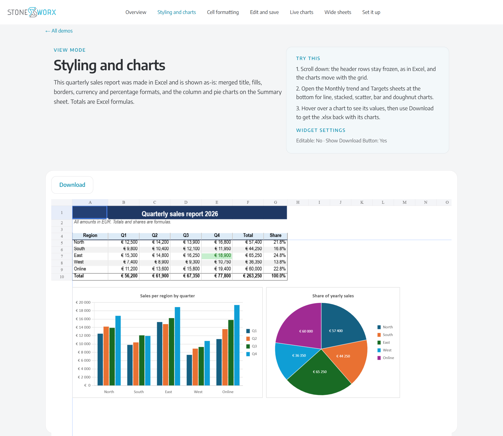
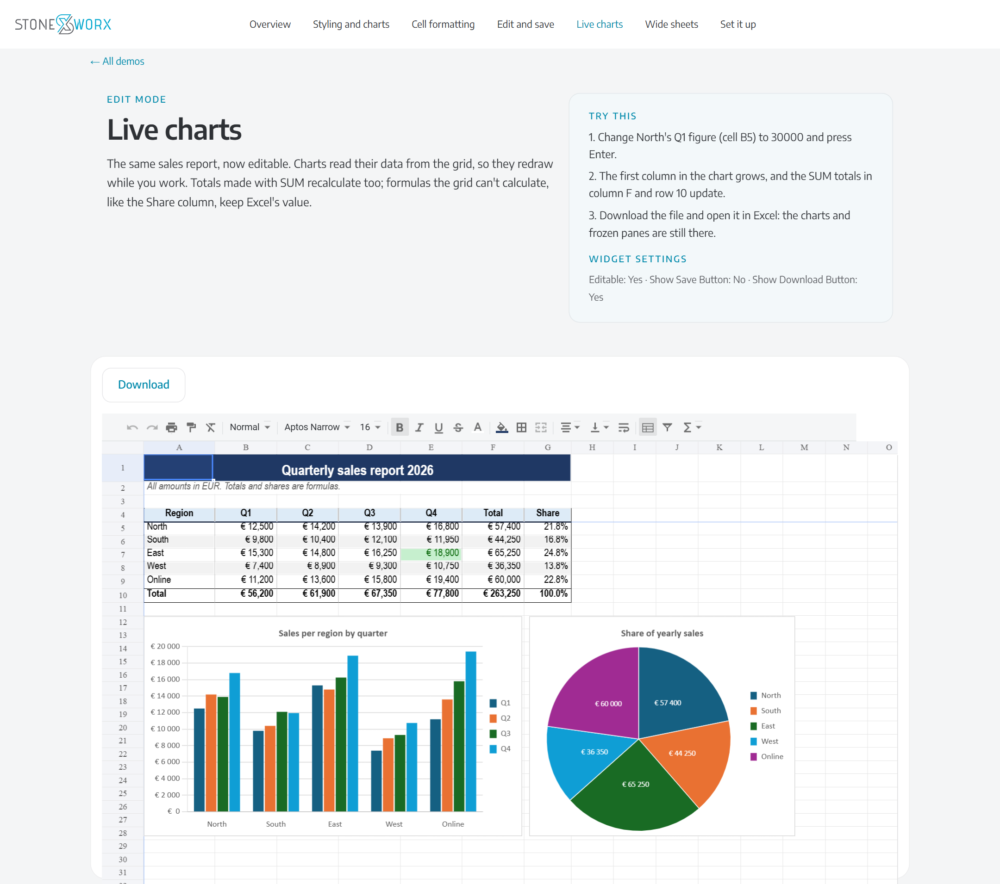
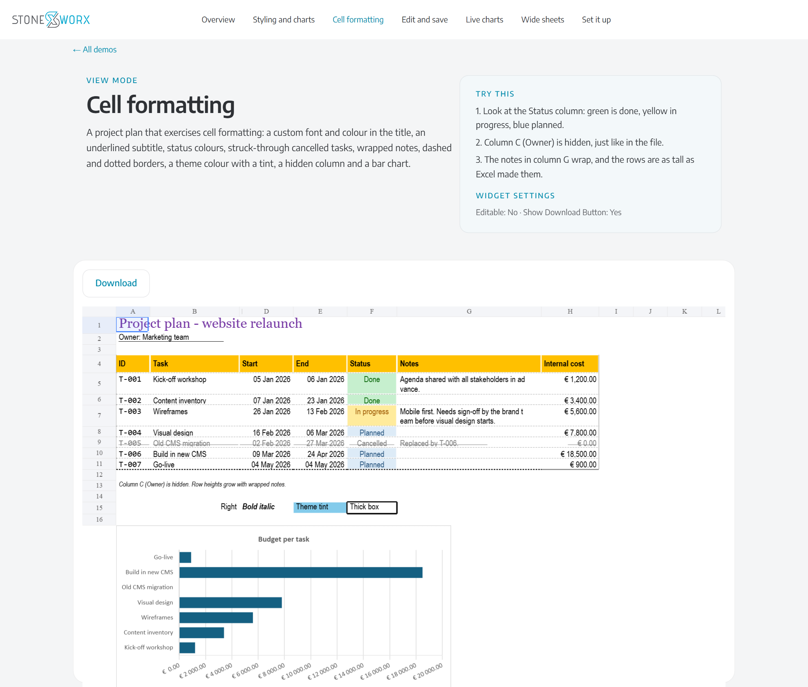
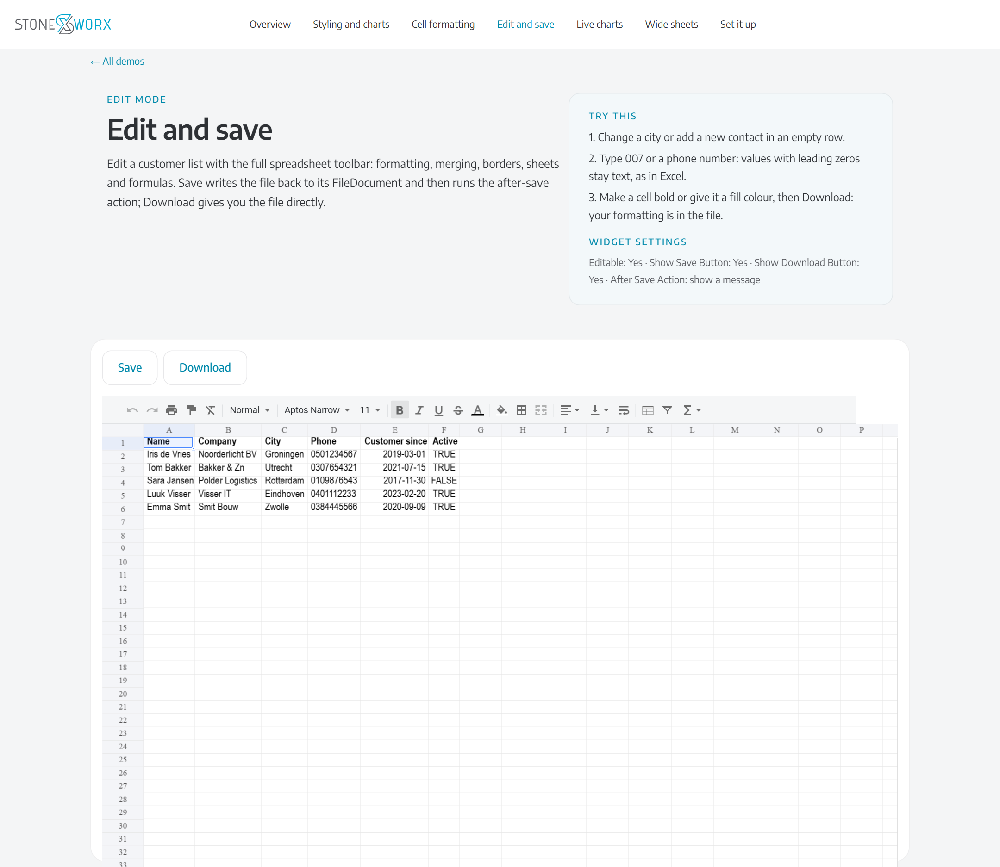
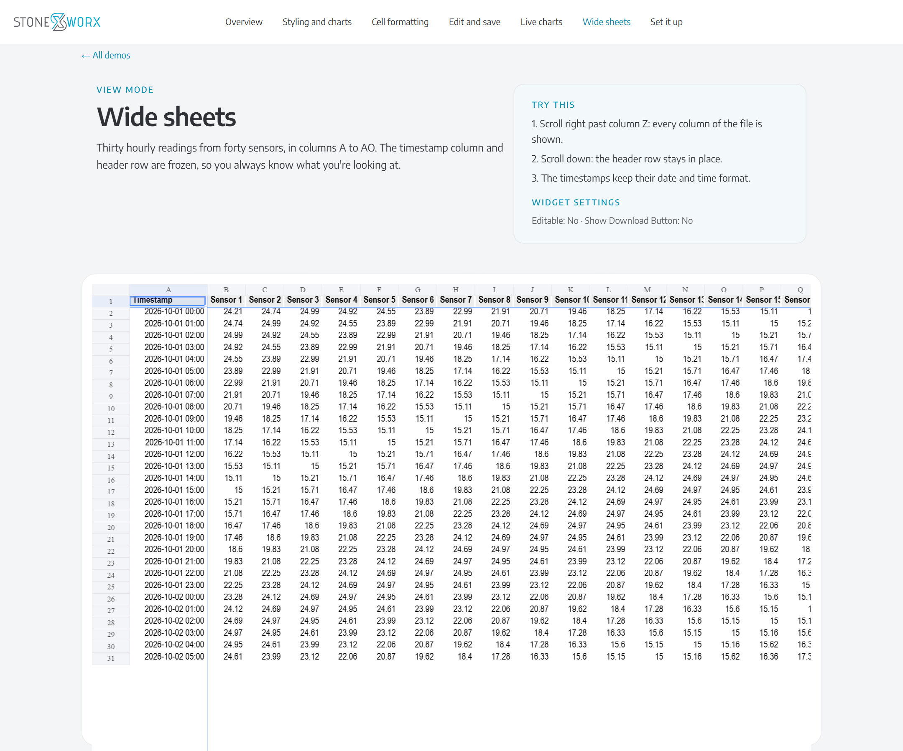
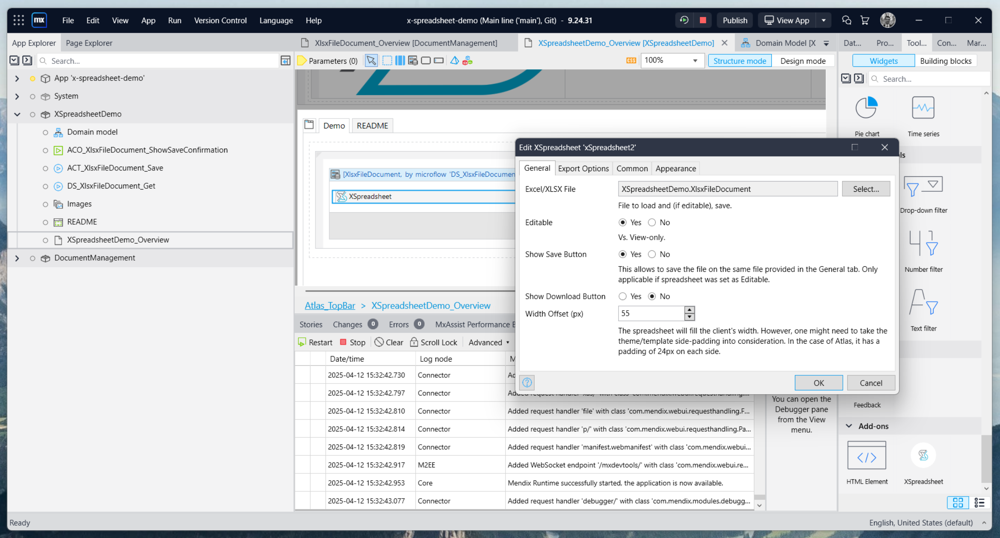
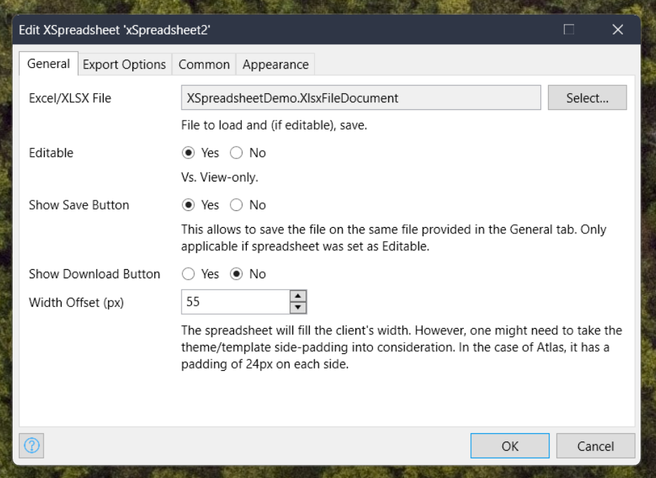

## Data Spreadsheet Mendix Pluggable Widget

A Mendix widget to view and edit excel files / spreadsheets based on https://github.com/myliang/x-spreadsheet.

**Requires Mendix 11 or later** (version 2.0.0 and up; use 1.0.x for Mendix 10).

## Features

View and edit your excel files. Pluggable widget based on the
[x-data-spreadsheet](https://github.com/myliang/x-spreadsheet) library that allows you to visualize and edit your excel
data directly from your Mendix web app. Current features include:

-   View / Edit mode;

-   Multiple sheets;

-   Formulas: about 280 Excel functions (with fast-formula-parser), absolute references and references to other sheets.
    They recalculate as you edit; loaded formulas the engine can't reproduce keep the result Excel saved;

-   Excel styling: fonts, font colours, fills, borders, alignment, wrapped text, column widths, row heights, hidden
    rows/columns and frozen panes. Styles are kept when you save or download;

-   Charts and pictures: column, bar, line, area, pie, doughnut, scatter and radar charts, with data labels, secondary
    axes and trendlines, are drawn over the grid where Excel placed them. They follow scrolling and inserted rows and
    columns, and update when you edit their data. They are kept when you save or download as .xlsx/.xlsm;

-   Custom toolbar;

-   Possibility to show download and/or save button(s). Download writes the configured Book Type with the matching
    extension; Save always keeps the format of the loaded file, so a workbook is never replaced by, say, a CSV;

-   Height: a fixed height in pixels, a height set on the widget with CSS (its class or style), or the window height;

-   Possibility to add an After Save activity, such as a nanoflow to show a success message;

-   Save method: Direct (stores the file right away) or Through the file property (Mendix's file upload API; commit the
    object in After Save Action);

-   Translatable Save and Download captions;

-   Export settings fully customizable;

-   Customize css: the widget's root has the class `xspreadsheet-widget` (plus your own class), and the grid sits in
    `.xs-grid`. The old `#gridctr` id still works but isn't unique when a page has several spreadsheets.

## Screenshots

Taken from the [demo app](https://x-spreadsheet-demo-sandbox.mxapps.io/index.html).

**Styling and charts.** A read-only sales report with merged headers, number formats, frozen rows, and the workbook's
column and pie charts placed where Excel put them.

**Live charts.** The same report in edit mode. Change a quarter and the SUM totals, shares and charts update as you
type.

**Cell formatting.** Fonts, fills, borders, wrapped text, strikethrough, a hidden column and a bar chart, all read from
the file.

**Edit and save.** A contact list with Save and Download buttons. Save writes the changes back to the file document.

**Wide sheets.** A sensor log with many columns and a frozen first column and header row.

## Usage

1. Add a dataview that fetches the .xlsx file you wish to display/edit.
2. Inside the dataview, add the x-spreadsheet widget.
3. Customize it. Make it editable/view-only; Decide if you want to show the Save/Download button. Define a width margin
   if needed.
4. In case you want to export (save/download), define the export options.

### General Settings

### Export Settings

## Security

-   Save runs in the browser: it stores the new content in the file document (through `mx.data.saveDocument` on the
    object's id). What protects the file is the entity access on your file document entity, so only give write access to
    roles that may change the file.
-   Files are parsed in the browser and treated as untrusted: font names must be plain names, pictures are only shown
    when they are raster images (PNG, JPEG, GIF, BMP, WebP), and files above 20 MB aren't opened.

## Demo project

-   [Mendix app running on the cloud](https://x-spreadsheet-demo-sandbox.mxapps.io/index.html)
-   [Mendix demo module (.mpk)](demo/)
-   [Marketplace widget](https://marketplace.mendix.com/link/component/237438)
<!-- - [Mendix demo scss (.scss)](https://github.com/joaodelopes/block-note-mendix/blob/main/demo/demo.scss) -->

## Issues, suggestions and feature requests

-   ⚠️ Performance is a problem when handling large files, because the whole file is parsed in the browser. Files above
    20 MB aren't opened.

-   ⚠️ Strange behaviour with the spreadsheet's horizontal scrollbar when using Mozilla Firefox. This seems unrelated to
    this widget's logic as per this
    [Stack Overflow post](https://superuser.com/questions/1720362/firefox-scroll-bar-disappearing).

-   ⚠️ Styling limitations: conditional formatting, rich text inside a cell, pattern and gradient fills (shown as a
    solid colour), diagonal borders and theme colours (saved as RGB) aren't supported.

-   ⚠️ Chart limitations: charts are view-only (drag, resize and chart editing aren't available), 3D charts are drawn
    flat, and trendlines other than linear and moving average are drawn as their linear fit. Chart data ranges don't
    move when rows are inserted inside them. Downloading in formats other than .xlsx/.xlsm drops charts.

-   ⚠️ The toolbar's percent, date and time formats only change how a value is shown (x-spreadsheet adds text around
    it), so they aren't saved as Excel number formats. Number and currency formats are.

-   ⚠️ Formulas with functions the engine doesn't support keep showing the value Excel saved, also after edits.

-   ⚠️ Fonts that aren't installed on the viewer's computer are drawn with the closest installed font (for example Aptos
    Narrow as Arial Narrow), so text can be slightly wider or narrower than in Excel. Styles are saved for .xlsx and
    .xlsm; other formats get values only.

-   🙌 Feel free to suggest us new features or report bugs.
